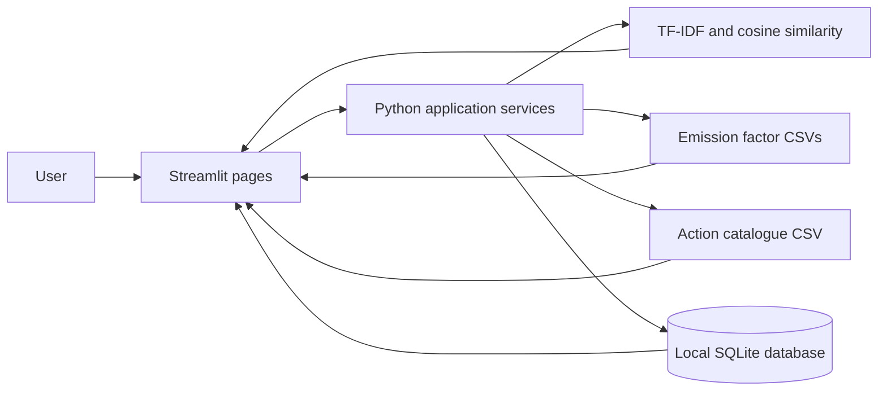

# AI-Based Sustainable Lifestyle Recommendation Platform

A student-built Streamlit application for exploring everyday sustainability habits. It stores a lifestyle profile, calculates a partial annualized carbon estimate from entered activity, ranks practical actions against the profile, and lets users track selected actions as goals.

> **Project status:** B.Tech mini-project prototype. The footprint is a partial estimate with mixed accounting boundaries. Recommendation relevance is not a confidence score or a measured emissions saving. Do not use the app as a verified inventory or public-facing environmental claim.

## Contents

- [Features](#features)
- [System design](#system-design)
- [Technology](#technology)
- [Project structure](#project-structure)
- [Run locally](#run-locally)
- [Data sources and calculations](#data-sources-and-calculations)
- [Recommendation model](#recommendation-model)
- [Data storage and privacy](#data-storage-and-privacy)
- [Limitations](#limitations)
- [Classroom demo walkthrough](#classroom-demo-walkthrough)
- [Evaluation and checks](#evaluation-and-checks)

## Features

- Responsive Evergreen landing page and sidebar navigation.
- Lifestyle questionnaire for commute, household energy, food, water, waste, and shopping habits.
- Dashboard with saved estimates, goals, and recent activity.
- Carbon calculator with a quick path for monthly fuel and electricity, plus optional food, water, and waste details.
- Annualized category emissions for transport fuel, grid electricity, and food; separate physical-volume indicators for water and waste.
- Personal recommendations ranked against profile habits, with explanations, eligibility notes, and catalogue sources.
- Save a recommendation as a goal, update progress, pause it, or mark it complete.
- Progress chart and comparison tools that exclude estimates with different factor sets, input formats, or reported emissions categories.
- Profile data downloads in JSON and a per-account SQLite backup. Password credentials are omitted.
- A confirmed reset option for the built-in demo profile only.

## System design

The application is a small modular monolith; it runs as one local Streamlit process and does not require a separate API server.



- `frontend/` contains the landing page, questionnaire, calculator, dashboard, recommendations, progress, and profile screens.
- `backend/services/` contains the footprint and recommendation application services.
- `ml/models/content_recommender.py` filters and ranks catalogue actions.
- `dataset/` contains action, factor, and evaluation CSVs.
- `database/` contains the SQLite schema, connection helper, and validated data operations.

## Technology

| Technology | Role |
|---|---|
| Python | Application and calculation logic |
| Streamlit | Interactive UI and page navigation |
| Pandas | Loading and shaping CSV/table data |
| NumPy | Numerical helpers used by the recommender |
| Scikit-learn | TF-IDF features and cosine similarity |
| Plotly | Interactive charts |
| SQLite | Local profile, estimate, recommendation, and goal storage |

## Project structure

```text
.
├── app.py                         # Streamlit entry point
├── requirements.txt               # Runtime dependencies
├── README.md                      # Project, setup, data, and demo guide
├── prd.md                         # Product requirements and proposed improvements
├── frontend/
│   ├── main.py                    # Page routing and sidebar
│   ├── styles.py                  # Shared styling and session initialization
│   ├── components/common.py       # Reusable UI elements
│   └── pages/                     # Home, auth, questionnaire, dashboard,
│                                  # calculator, recommendations, progress, profile
├── backend/
│   ├── models.py                  # Application data structures
│   ├── repositories/              # Catalogue data access
│   └── services/                  # Footprint, recommendation, and progress logic
├── ml/
│   ├── models/content_recommender.py
│   └── evaluate_recommender.py    # Offline ranking metrics
├── dataset/
│   ├── actions.csv
│   ├── emission_factors.csv
│   ├── food_emission_factors.csv
│   └── evaluation_profiles.csv
├── database/
│   ├── connection.py              # SQLite connection factory
│   ├── schema.py                  # Table creation and additive migrations
│   └── repository.py              # Validated CRUD, export, and backup operations
├── assets/images/                 # Landing-page illustration
├── utils/                         # Validation and logging helpers
└── tests/                         # Application smoke tests
```

The database file is created locally at `database/sustainable_lifestyle.db` on first run. It is ignored by Git and should not be committed.

## Run locally

### Requirements

- Python 3.10 or newer (the project is developed with Python 3.12).
- pip.
- Windows PowerShell, macOS, or Linux terminal.

### 1. Clone the project

```bash
git clone https://github.com/Vatsal-2-4/-AI-Based-Sustainable-Lifestyle-Recommendation-Platform-..git evergreen-platform
cd evergreen-platform
```

Alternatively, open a terminal in the project directory containing `app.py`.

### 2. Create and activate a virtual environment

**Windows PowerShell**

```powershell
python -m venv .venv
.\.venv\Scripts\Activate.ps1
```

**macOS/Linux**

```bash
python3 -m venv .venv
source .venv/bin/activate
```

### 3. Install dependencies

```bash
python -m pip install --upgrade pip
python -m pip install -r requirements.txt
```

### 4. Start the app

```bash
python -m streamlit run app.py
```

Open the local URL printed by Streamlit, usually `http://localhost:8501`. Stop the app with `Ctrl+C` in the terminal. The database schema is initialized automatically. To initialize it separately:

```bash
python -m database.init_db
```

## Data sources and calculations

Factors are stored in CSV files so the application can show their units, geography, source year, and limitations alongside results.

| Input | Source and factor | Calculation and scope |
|---|---|---|
| Petrol and diesel | IPCC 2006 default mobile-combustion CO₂ factors, net calorific values, and fuel densities (see links below and `dataset/emission_factors.csv`) | Monthly litres × 12 × derived kg CO₂/litre. Direct combustion CO₂ only. |
| Electricity | Central Electricity Authority (CEA) India grid factor, FY 2023–24: **0.727 kg CO₂/kWh** | Monthly kWh × 12 × grid factor. National grid-average proxy. |
| Food products | Poore & Nemecek (2018) factors as processed by Our World in Data (OWID); global mean product factors based on 2010 data | Entered kg/week × 52 × kg CO₂e/kg product. Product examples and values are in `dataset/food_emission_factors.csv`. |
| Water | No household CO₂e factor is applied | Litres/person/day × 365, shown as an annual volume only. |
| Waste | No generic disposal factor is applied | Entered kg/week × 52, shown by waste stream only. |

Sources:

- [CEA CO₂ Baseline Database](https://cea.nic.in/cdm-co2-baseline-database/)
- [IPCC 2006 Guidelines, Volume 2, Chapter 3: Mobile Combustion](https://www.ipcc-nggip.iges.or.jp/public/2006gl/pdf/2_Volume2/V2_3_Ch3_Mobile_Combustion.pdf)
- [IPCC 2006 Guidelines, Volume 2, Chapter 1: Introduction and fuel properties](https://www.ipcc-nggip.iges.or.jp/public/2006gl/pdf/2_Volume2/V2_1_Ch1_Introduction.pdf)
- [OWID food emissions dataset](https://ourworldindata.org/grapher/ghg-per-kg-poore?tab=table)
- [Poore & Nemecek, Science (2018)](https://doi.org/10.1126/science.aaq0216)

The total adds transport combustion CO₂, grid-electricity CO₂, and food life-cycle CO₂e. These factors have different system boundaries, and food factors are global rather than India-specific. The total is therefore partial. Monthly and weekly inputs are annualized; a saved estimate is a snapshot of entered habits, not emissions measured over the year. Zero means no amount was reported, not that an activity has no impact.

## Recommendation model

The action catalogue in `dataset/actions.csv` is curated from public sustainability guidance. Each row has an ID, category, title, description, matching terms, eligibility rule, qualitative impact/cost tiers, difficulty, and source link.

Catalogue references include [Mission LiFE India](https://missionlife-moefcc.nic.in/List-of-Action.php) and the [Bureau of Energy Efficiency](https://www.beeindia.gov.in/); each action row identifies its source.

The content-based recommender:

1. Case-folds and normalizes profile and action text, and adds matching phrases for common commute, energy, and lifestyle responses.
2. Uses scikit-learn `TfidfVectorizer` with English stop words, unigrams, bigrams, and sublinear term frequency to represent the profile and action descriptions.
3. Filters actions that fail explicit eligibility rules, such as public-transit availability or composting access.
4. Uses cosine similarity as the main text-match signal, with a transparent reranking score:

   `0.62 × text similarity + 0.22 × category fit + 0.08 × ease + 0.05 × qualitative impact tier + 0.03 × cost fit`

Category fit is a hand-set heuristic based on profile fields such as commute mode and frequency, electricity and AC use, diet, and waste habits; ease, impact tier, and cost fit are catalogue/profile rules. These weights are transparent prototype choices, not learned model parameters. The interface shows which profile details matched. The relevance score is not a probability, a sustainability score, or a prediction of kg CO₂e saved. The catalogue does not contain validated user-specific savings, so the app does not claim numerical action reductions.

## Data storage and privacy

- User profile responses, footprint estimates, recommendations, and goals are stored in the local SQLite file. The application has no cloud database or remote API for these records.
- The JSON export contains the current account's application records. The SQLite download is a separate backup database containing only that account's records; both omit password credentials.
- There is no automated restore workflow yet. Keep downloaded backups somewhere safe; the built-in app does not upload or sync them.
- **Reset demo data** is visible for the built-in demo profile. It deletes that profile's saved questionnaire answers, estimates, recommendations, and goals after confirmation, while retaining the demo profile itself.
- The Profile page also offers account deletion. This permanently removes that account and its linked records.
- Local account passwords are stored as salted PBKDF2 hashes. This prototype has no password recovery, login throttling, or production-grade deployment security.

## Limitations

- Transport includes direct petrol/diesel combustion only; it excludes upstream fuel production, vehicle manufacture, and non-CO₂ vehicle gases. Public transit is not included in the fuel-based calculator.
- Electricity uses an India-wide grid average, not a state-specific or time-of-day mix.
- Food factors are global averages based on data reported for 2010 and published in 2018. Local production and product differences may be substantial.
- Water and waste are not included in the CO₂e total because reliable locally matched factors and, for waste, material/disposal detail are unavailable in this app.
- The estimate is not a full life-cycle assessment, a verified inventory, or proof of emissions change.
- Recommendation relevance depends on catalogue text and manually defined rules/weights. Evaluation labels are small project-team judgments, not population ground truth.
- Qualitative action tiers do not equal measured environmental savings. The app does not currently provide a validated sustainability score.

## Classroom demo walkthrough

A 5–7 minute demo can use the built-in demo profile without creating an account:

1. Start the app and open **Dashboard**. Point out the guided three-step onboarding panel.
2. Open **Questionnaire**, change one or two habits, and save. Explain that these answers drive recommendation matching.
3. Open **Carbon footprint**. Enter a typical month of fuel and electricity. Expand the details to enter weekly food amounts. Show the live category chart and explain that water/waste remain volume indicators.
4. Open **Emission factors and sources** and **Assumptions and limitations** to show the citations and partial-estimate boundary.
5. Open **Recommendations**. Expand a recommendation's “Why this matched” details; add an action as a goal.
6. Open **Progress tracking**. Update or complete the goal. Save a second footprint estimate with the same factor set and the same reported categories, then compare the two snapshots and category changes.
7. Open **Profile** to show JSON export, account-only SQLite backup, and the confirmed demo reset option. Do not reset during a live presentation unless you intend to clear demo data.

For a clean demo, use the Profile page's confirmed demo reset option before the presentation, then rerun the onboarding steps.

## Evaluation and checks

Run the automated smoke tests from the project root:

```bash
python -m unittest discover -s tests -v
```

Evaluate the recommender on the small labeled scenarios:

```bash
python -m ml.evaluate_recommender
```

This prints Precision@5, Recall@5, NDCG@5, and catalogue coverage. These results only describe the provided manual scenarios; they are not evidence of broad real-world recommendation quality. Calculation changes should also be checked against independent hand calculations and the factor sources.

## Academic alignment

The project is intended as a third-year B.Tech Artificial Intelligence and Machine Learning mini project. It combines data processing, a documented calculation service, content-based retrieval/ranking, relational data persistence, and an interactive dashboard. It supports classroom discussion of transparent modelling and environmental data limitations. Do not claim evaluation results that have not been run and recorded.

## License

No license has been selected. Add a `LICENSE` file before distributing or reusing the project outside the team.
