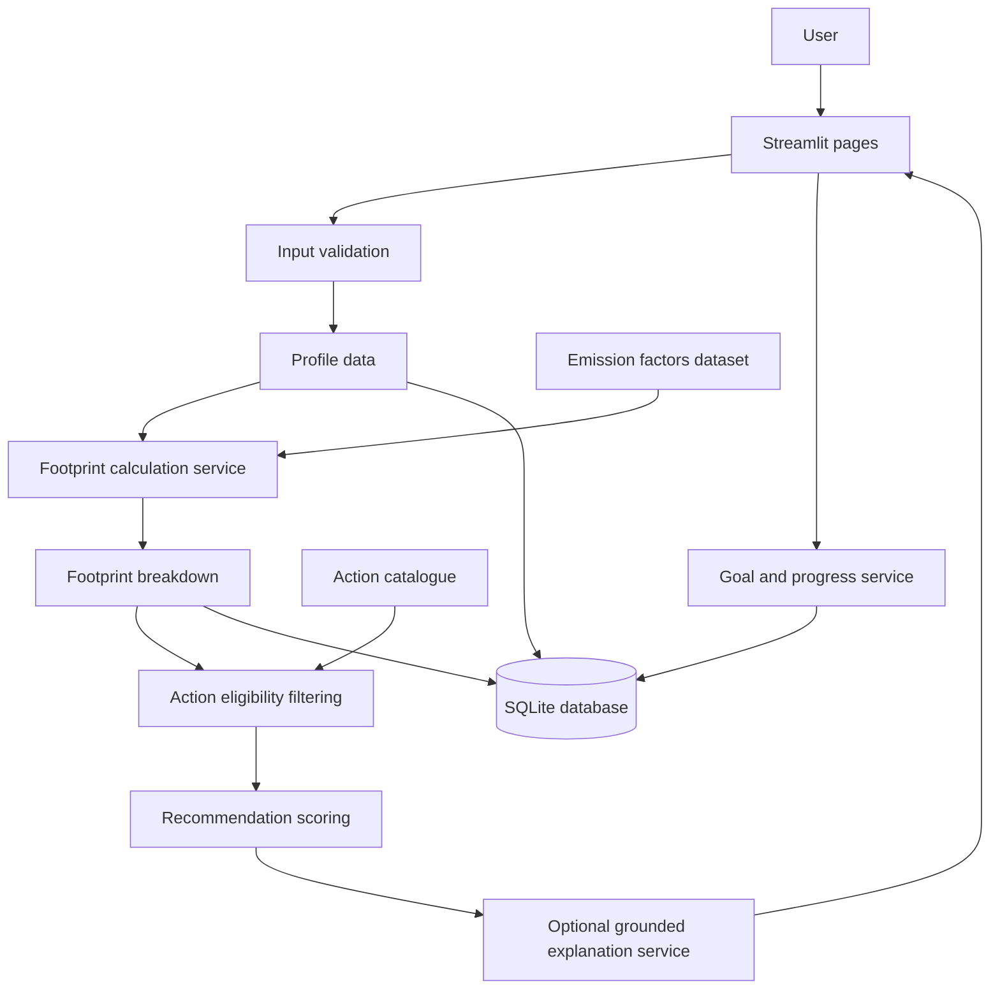

# AI-Based Sustainable Lifestyle Recommendation Platform

A Streamlit project that helps people explore how daily lifestyle choices relate to their estimated carbon footprint and discover practical sustainability actions. The prototype combines a lifestyle questionnaire, category based footprint view, content-ranked recommendations, and SQLite-backed goal tracking in a clean interface.

> **Project status:** Academic prototype/demo. The dashboard and progress charts use saved application data. The calculator uses documented factors with partial and mixed system boundaries; it is not a complete India-specific footprint. Passwords are salted PBKDF2 hashes in SQLite, but this local prototype has no account recovery, login rate limiting, or production deployment controls.

## Contents

- [Project overview](#project-overview)
- [Problem](#problem)
- [Objectives](#objectives)
- [Features](#features)
- [System architecture](#system-architecture)
- [Data flow](#data-flow)
- [Technology stack](#technology-stack)
- [Project structure](#project-structure)
- [Getting started](#getting-started)
- [How to use the app](#how-to-use-the-app)
- [Data and calculation notes](#data-and-calculation-notes)
- [Current limitations](#current-limitations)
- [Roadmap](#roadmap)
- [Academic alignment](#academic-alignment)
- [Contributing](#contributing)

## Project overview

The AI-Based Sustainable Lifestyle Recommendation Platform is a student project concept for turning environmental awareness into manageable personal action. It aims to estimate an individual’s annual greenhouse gas footprint in kilograms of carbon dioxide equivalent (kg CO₂e) across lifestyle categories such as transport, food, household energy, shopping, and waste. It then aims to rank practical actions based on their estimated impact and fit with a person’s budget, housing, location, and preferences.

The intended system uses deterministic, documented calculations for footprint and savings. Machine learning can support content-based action matching, while a language model can provide plain-language explanations grounded in catalogue facts. The model should not invent or calculate the numerical impact values.

## Problem

General sustainability tip lists offer the same advice to everyone. Carbon calculators may provide a total without clear next steps, while habit tracking tools may not explain which actions matter most. Users need an accessible way to understand the major sources of their footprint and identify changes that are both relevant and feasible for their circumstances.

## Objectives

- Estimate an annual lifestyle footprint across multiple categories.
- Present a category-wise breakdown and explain the assumptions behind estimates.
- Recommend actions ordered by potential impact and user suitability.
- Include approximate cost, difficulty, applicability, and evidence for each action.
- Let users save chosen actions as goals and track progress.
- Evaluate calculation accuracy, recommendation relevance, usability, and response time.

## Features

### Available in the current UI demo

- **Home page:** interactive Get started, How it works, and Data and privacy tabs, guided next-step actions, and direct navigation to key tasks.
- **Login and registration screen:** local SQLite accounts with salted PBKDF2 password hashes, plus a sidebar sign-out action; no external identity provider or account recovery.
- **Lifestyle questionnaire:** editable transport, diet, housing, budget, energy, waste, and location fields saved in SQLite.
- **Dashboard:** selectable saved estimates, category explorer, water/waste indicators, compatible estimate history, and inline goal progress/completion; empty states prompt the user to create data.
- **Carbon footprint page:** user-entered fuel, electricity, food, water, and waste amounts; supported profile electricity is prefilled; activity inputs are saved with estimates; documented-factor kg CO₂e total and category chart; separate water/waste volume charts; source notes and limitations.
- **Recommendations page:** ranked example actions with fit details and an Add goal interaction.
- **Progress tracking:** SQLite-backed goals, editable progress and completion, with a trend chart after multiple estimates are saved.
- **Profile page:** displays the current saved profile and links to questionnaire editing, JSON data export, and account/data deletion.
- **Responsive visual design:** green, white, and neutral palette, shared typography, reusable components, and sidebar navigation.

### Personalized content-based recommender

The recommendations page now ranks a curated action catalogue using TF-IDF text features and cosine similarity. It matches profile details such as commute mode, electricity use, diet, water use, food waste, shopping frequency, and waste segregation to action descriptions and matching terms. Eligibility rules can filter actions that are unavailable to a particular user. A transparent reranking step also considers category relevance, effort, qualitative impact tier, and cost tier. The displayed match score is a profile relevance score; it is not a confidence probability or a measured carbon saving.

The catalogue lives in `dataset/actions.csv`. Fields include stable action ID, category, title, description, match terms, eligibility rule, qualitative impact and cost tiers, difficulty, and source. Actions are curated from public Mission LiFE guidance and the Bureau of Energy Efficiency. No kg CO₂e reduction is shown by this model because user-specific, source-verified action savings are not yet available. See `dataset/README.md` for field definitions and caveats.

Evaluate ranking against the small manually labeled scenario set with:

```bash
python -m ml.evaluate_recommender
```

Run database, account, calculator, and saved-input smoke checks with:

```bash
python -m unittest discover -s tests -v
```

The script reports Precision@5, Recall@5, NDCG@5, and catalogue coverage. The evaluation profiles and expected action IDs are project-team labels for repeatable demonstration; they are not population-level ground truth.

### Current limitations and next steps

- Verified India-relevant emission factors with sources, units, geography, and publication year.
- User-specific verified action savings and regional footprint factors.
- Account recovery, login throttling, and deployment-grade session security.
- A defined, evidence-backed sustainability score and report export.
- Evaluation with hand-calculated profiles and usability feedback.

## System architecture

The project uses a simple modular monolith. Streamlit provides the interface, Python modules contain calculation and recommendation logic, CSV files provide action and factor data, and SQLite persists users, questionnaire responses, estimates, recommendations, and goals. A separate web API or microservice deployment is not required for the mini project.



### Component responsibilities

- **Frontend (`frontend/`):** Streamlit page rendering, navigation, styling, and reusable UI components. It gathers input and displays outputs from application logic.
- **Backend (`backend/`):** profile data structures, footprint calculations, recommendation ranking, explanation orchestration, progress operations, and data repository access.
- **Machine learning (`ml/`):** optional feature preparation and content similarity helpers. The first usable recommender can remain rule based and explainable.
- **Dataset (`dataset/`):** action catalogue and emission factor source files. Values require verification before use for real estimates.
- **Database (`database/`):** SQLite connection, schema, initializer, and future migration scripts.
- **Utilities (`utils/`):** shared input validation and logging helpers.
- **Assets (`assets/`):** images, illustrations, logos, and icons used by the interface.

## Data flow

1. The user enters lifestyle details through the Streamlit questionnaire or calculator.
2. The application validates units and acceptable ranges.
3. A footprint service applies appropriate emission factors to activity data and calculates category totals.
4. The recommendation service removes actions that do not apply to the user, then scores and ranks eligible actions.
5. The interface presents the footprint and action list. User-selected goals and progress updates are saved to SQLite.

## Technology stack

| Technology | Use |
|---|---|
| Python | Application and business logic |
| Streamlit | Interactive web interface and navigation |
| pandas | Tabular data and catalogue handling |
| NumPy | Numerical helpers for analysis and scoring |
| scikit-learn | Optional text feature vectorization and similarity |
| Plotly | Interactive charts |
| SQLite | Lightweight local persistence |

## Project structure

```text
.
├── app.py                         # Streamlit entry point
├── requirements.txt               # Python package dependencies
├── prd.md                         # Product requirements document
├── frontend/
│   ├── main.py                    # Sidebar navigation and page routing
│   ├── styles.py                  # Shared CSS and session state initialization
│   ├── components/common.py       # Reusable metrics and page header
│   └── pages/
│       ├── home.py                # Landing page
│       ├── auth.py                # Local registration and sign-in UI
│       ├── questionnaire.py       # Lifestyle inputs
│       ├── dashboard.py           # Summary metrics and charts
│       ├── recommendations.py    # Content-ranked action catalogue
│       ├── calculator.py          # Editable footprint estimate
│       ├── progress.py            # Goal and progress interface
│       └── profile.py             # Demo profile view
├── backend/
│   ├── models.py                  # Profile data structures
│   ├── repositories/              # Catalogue and persistence access
│   └── services/                  # Footprint, recommendations, explanations, progress
├── ml/models/                     # Feature extraction and similarity helpers
├── ml/evaluate_recommender.py     # Offline ranking metrics on labeled scenarios
├── dataset/
│   ├── actions.csv                # Starter action catalogue schema
│   ├── evaluation_profiles.csv   # Manually labeled evaluation scenarios
│   ├── emission_factors.csv       # CEA and IPCC factor values with metadata
│   ├── food_emission_factors.csv  # OWID/Poore-Nemecek food factors
│   ├── raw/                       # Original source data
│   └── processed/                 # Prepared datasets
├── database/
│   ├── connection.py              # SQLite connection helper
│   ├── schema.py                  # Database tables
│   ├── init_db.py                 # Database initialization command
│   └── migrations/                # Future schema changes
├── utils/                         # Validation and logging helpers
├── assets/                        # Images and icons
└── tests/                          # Test suite location
```

## Getting started

### Requirements

- Python 3.10 or newer recommended.
- pip.
- Windows PowerShell, macOS Terminal, or a Linux shell.

### 1. Get the project and enter its folder

```bash
git clone <repository-url>
cd <repository-folder>
```

If you already have the project files, open a terminal in the project root (the folder containing `app.py`).

### 2. Create and activate a virtual environment

**Windows PowerShell**

```powershell
python -m venv .venv
.\.venv\Scripts\Activate.ps1
```

**macOS or Linux**

```bash
python3 -m venv .venv
source .venv/bin/activate
```

### 3. Install dependencies

```bash
python -m pip install --upgrade pip
pip install -r requirements.txt
```

### 4. Run the Streamlit app

```bash
streamlit run app.py
```

Streamlit prints a local URL, normally `http://localhost:8501`, which you can open in a browser. Stop the server with `Ctrl+C` in the terminal.

### Optional: initialize the SQLite schema

```bash
python -m database.init_db
```

This creates the local SQLite database file. Questionnaire responses, footprint estimates, recommendations, and goals are persisted there.

## How to use the app

1. Open **Home** and choose the dashboard or questionnaire.
2. Enter sample lifestyle details and save the profile.
3. Review the dashboard and footprint category chart.
4. Enter recent fuel, electricity, food, water, and waste amounts on the carbon footprint page.
5. Add suggested actions as goals on the Recommendations page.
6. Update progress or mark goals complete on the Progress tracking page.
7. Use the sidebar at any time to move between screens.

## Data and calculation notes

The recommendation catalogue contains curated qualitative tiers, and estimated savings are not computed. The calculator's emission factors have different geographic and accounting boundaries, so its results are partial estimates, not a complete locally precise footprint:

- Replace placeholders with authoritative, traceable sources relevant to the intended geography.
- Store units, geography, source year, and assumptions for each factor.
- Validate calculations against independently hand-calculated profiles.
- Label estimates as approximate and avoid implying that they measure verified reductions.
- Keep numerical values out of LLM-generated content; the model should only explain values supplied by the application.

### Carbon calculator factors

The Carbon footprint page now reads documented factors from `dataset/emission_factors.csv` and `dataset/food_emission_factors.csv`. It calculates vehicle fuel combustion from user-entered monthly petrol/diesel litres using IPCC defaults, electricity from the CEA FY 2023-24 India grid-average factor, and food from the Poore and Nemecek global per-kilogram product factors as processed by Our World in Data. The page shows factor values, links, and scope notes. Fuel and electricity factors cover direct combustion/grid CO₂, while food factors are life-cycle CO₂e; this makes the result a partial estimate with mixed boundaries.

Water use and waste generation are shown as annual litres and kilograms. They are excluded from the emissions total because household-water emissions need local supply/treatment factors and waste emissions need material composition and local disposal-pathway data. The inputs are still useful for viewing resource consumption without implying an unsupported CO₂e number. Sources include the [Central Electricity Authority CO₂ Baseline Database](https://cea.nic.in/cdm-co2-baseline-database/), [IPCC 2006 Guidelines for Mobile Combustion](https://www.ipcc-nggip.iges.or.jp/public/2006gl/pdf/2_Volume2/V2_3_Ch3_Mobile_Combustion.pdf), and the [Our World in Data food emissions dataset](https://ourworldindata.org/grapher/ghg-per-kg-poore?tab=table).

## Current limitations

- Local accounts use salted password hashes, but there is no account recovery, rate limiting, or production-grade session protection.
- Profile responses, footprint estimates, recommendations, and progress are stored in SQLite; some display preferences remain in the Streamlit session.
- No sustainability score or verified action savings are shown because those values are not currently calculated.
- The model provides content-based ranking; recommendations are not proof that an action will cause a quantified reduction.

## Roadmap

1. Validate factors and recommendation quality with local user research and independent calculations.
2. Add regional factors and user-specific quantified action savings where evidence supports them.
3. Add account recovery, rate limiting, and deployment-grade security before any public deployment.
4. Add a clearly defined evidence-backed sustainability score and report export if required.
5. Continue improving accessibility, error handling, and test coverage.

## Academic alignment

The project is intended as a third-year B.Tech Artificial Intelligence and Machine Learning mini project. Its technical scope combines data processing, transparent calculation, recommendation ranking, optional content-based similarity, database design, and a user-facing dashboard. It also relates to the United Nations Sustainable Development Goals **12: Responsible Consumption and Production** and **13: Climate Action**. Any evaluation claims should be supported by measured project results.

## Contributing

For a student team, a practical contribution workflow is:

1. Create a branch for one feature or fix.
2. Keep UI, services, datasets, and database changes in their respective folders.
3. Document emission factor changes with source, units, geography, and year.
4. Add tests for calculation or ranking behavior when extending those modules.
5. Review changes and run the app locally before merging.

## License

No license has been selected yet. Add a `LICENSE` file before distributing or reusing the project outside the team.
